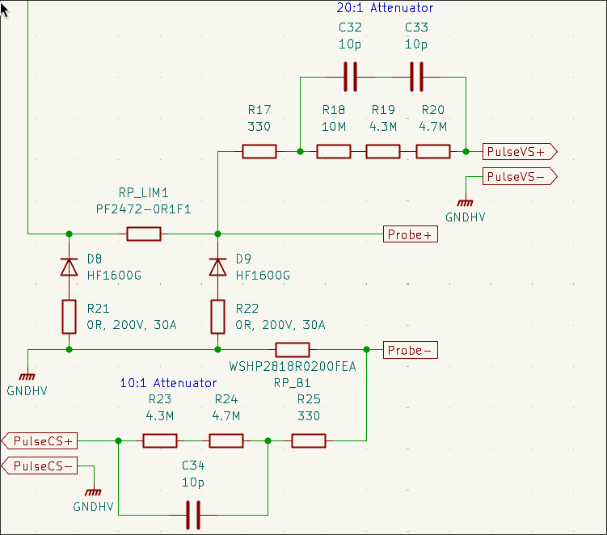

# Ongoing Design and Evaluation Work

## Electronic Design
### Pulse Feedback
Currently, the two pulse feedback lines (`PulseCS` and `PulseVS`) are implemented as naive attenuator circuits for connection to a $1\text{M}\Omega$ oscilloscope input. `PulseVS` functions as a 20:1 attenuator between the `Probe+` and `GNDHV` nets. `PulseCS` functions as a 10:1 attenuator between the `Probe-` and `GNDHV` nets, with a $20\text{m}\Omega$ current sense resistor also separating the nets. The `PulseCS` attenuator signal is proportional to the current through the current sense resistor, and can also be used in conjunction with the `PulseVS` attenuator to determine the voltage drop over `Probe+` to `Probe-` (rather than just `Probe+` to `GNDHV`).  

**Open problems with this design:**
- The CL05C100JB5NNNC capacitors selected for the attenuator circuits are only rated for 50V, but the voltage drop over the `PulseVS` attenuator is expected to be much greater
- Component selection should be optimized to minimize the impact of temperature variation and high voltage loading on measured signal. In practice
- For high precision measurements, very low tolerance component selection is necessary, increasing cost

Something like the [TI TPS4141](https://www.ti.com/lit/ds/symlink/tps4141-q1.pdf?ts=1792568133817&ref_url=https%253A%252F%252Fwww.ti.com%252Fproduct%252FTPS4141-Q1) would basically solve the issues of high voltage loading, temperature drift, and eliminate the need for careful component matching for high precision measurement. However, this would add a bit of control complexity and, at $5-$6 per IC, significant cost.

It might make more sense to place a dedicated resistive divider network in front of the attenuator in order to reduce the required voltage rating of the capacitors. The attenuation factor could then be reduced, perhaps even to 1:1 having it just serve as an oscilloscope probe connection point.

**Next Steps**
- [ ] Create simulation environment of `PulseCS` and `PulseVS` attenuators. This should obviously consider the non-ideal properties of the resistors (especially TCR and VCR) and capacitors.
- [ ] Perform component selection for attenuator circuits
- [ ] Simulate impact of temperature variation, bias, loading
- [ ] Simulate or calculate impact of component variation
- [?] If necessary, optimize PCB layout to minimize temperature gradients and parasitic effects
- [ ] Determine some kind of calibration procedure compensate for component / temperature variations on real device

### High Voltage Control Feedback
The `HVVS+` line measures the voltage across the capacitor bank, and is sampled by one of the MCU's integrated ADCs for control system feedback. In revision 0.2, the design used a 1000:1 resistor divider network followed by a 45MHz RC low pass filter, which then fed the MCU's ADC. 

The main issue with the design as of revision 0.2 is that the resistor divider network had an impedance far too high for the ADC's sample and hold capacitor to charge correctly. When the ADC was sampling while no voltage was present on the capacitor bank, it would actually charge the `HVVS+` line by several hundred mV. These issues led to significant voltage ripple by the high voltage generator. Another less (but still) significant issue is that the `HVVS+` line is referenced to `GND`, not the negative side of the high voltage capacitor bank. 

Conveniently, the obvious solution to both of these issues is to buffer the feedback signal with a low noise opamp (or perhaps two). This would allow a differential measurement of the divided capacitor bank voltage to be shifted to a `GND` referenced signal, and allow the ADC to sample the signal at whatever rate and sample hold time is optimal for the control design.

**Next Steps**
- [ ] Basic design of the buffering circuit with ideal components
- [ ] Research other considerations for good buffer design (e.g. temperature, parasitics, ...)
- [ ] Opamp component selection
- [ ] Layout

## Firmware
### Voltage Generation Control System
After the [High Voltage Control Feedback](#high-voltage-control-feedback) design changes have been made, the precision and stability of the voltage generation control system can be re-assessed. 

## Host Interface
There have been several instances of the device spontaneously disconnecting from the host, but the root cause has not yet been diagnosed.