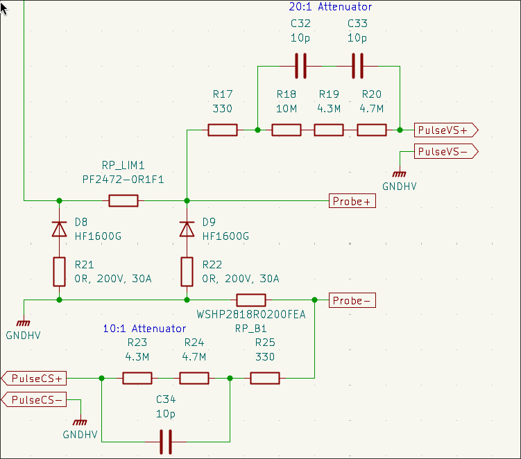

# Ongoing Design and Evaluation Work

## Electronic Design
### Pulse Feedback
Currently, the two pulse feedback lines (`PulseCS` and `PulseVS`) are implemented as naive attenuator circuits for connection to a $1\text{M}\Omega$ oscilloscope input. `PulseVS` functions as a 20:1 attenuator between the `Probe+` and `GNDHV` nets. `PulseCS` functions as a 10:1 attenuator between the `Probe-` and `GNDHV` nets, with a $20\text{m}\Omega$ current sense resistor also separating the nets. The `PulseCS` attenuator signal is proportional to the current through the current sense resistor, and can also be used in conjunction with the `PulseVS` attenuator to determine the voltage drop over `Probe+` to `Probe-` (rather than just `Probe+` to `GNDHV`).

#### Open problems with this design:
- The CL05C100JB5NNNC capacitors selected for the attenuator circuits are only rated for 50V, but the voltage drop over the `PulseVS` attenuator is expected to be much greater
- Component selection should be optimized to minimize the impact of temperature variation and high voltage loading on measured signal. In practice
- For high precision measurements, very low tolerance component selection is necessary, increasing cost
- These measurement ports must be connected to an oscilloscope using a lossy / resistive coaxial cable, which are not commercially available (unless sold as a complete passive oscilloscope probe) and must be custom made.

It might make more sense to place a dedicated resistive divider network in front of the attenuator in order to reduce the required voltage rating of the capacitors. The attenuation factor could then be reduced, perhaps even to 1:1 having it just serve as an oscilloscope probe connection point.

#### Next Steps / Progress
- [x] Create simulation environment of `PulseCS` and `PulseVS` attenuators with ideal components.
- [ ] Design and simulate actively buffered measurement ports with ideal components. 
- [ ] Create similar simulation considering non-ideal properties of components (e.g. TCR and VCR of resistors).
- [ ] Passive component selection for measurement ports.
- [ ] Simulate impact of temperature variation, bias, loading.
- [ ] Simulate or calculate impact of component variation.
- [?] If necessary, optimize PCB layout to minimize temperature gradients and parasitic effects.
- [ ] Determine some kind of calibration procedure compensate for component / temperature variations on real device.

**(11-09-26)** A simulation of both measurement ports was implemented in QSPICE using ideal components. QSPICE was selected after experiencing many convergence issues attempting to simulate the same circuit in ngspice. A transient simulation of a 500V pulse with 5ns rise / fall time and 30ns pulse width was performed, and the results showed acceptable response observed at the oscilloscope inputs.

However, these ports require connection to the oscilloscope inputs using a specialized lossy coax cable, which is only found in passive oscilloscope probes. This cable (to my knowledge) cannot be purchased outright. This means that custom cables need to be fabricated using passive probes, SMA connectors, and crimping tools, to effectively use these measurement ports. While the fabrication process for these cables is not complex, it would likely be more cost and time effective to buffer these ports to enable the use of standard $50\Omega$ SMA to BNC cables. 

For example, the [TI BUF602](https://www.ti.com/lit/ds/symlink/buf602.pdf?ts=1793563315318&ref_url=https%253A%252F%252Fwww.ti.com%252Fproduct%252FBUF602) could be added at the output of the attenuator circuit for each port. This could drive a $50\Omega$ line without adding more than a few components per port to the BOM.  

### High Voltage Control Feedback
The `HVVS+` line measures the voltage across the capacitor bank, and is sampled by one of the MCU's integrated ADCs for control system feedback. In revision 0.2, the design used a 1000:1 resistor divider network followed by a 45MHz RC low pass filter, which then fed the MCU's ADC. 

The main issue with the design as of revision 0.2 is that the resistor divider network had an impedance far too high for the ADC's sample and hold capacitor to charge correctly. When the ADC was sampling while no voltage was present on the capacitor bank, it would actually charge the `HVVS+` line by several hundred mV. These issues led to significant voltage ripple by the high voltage generator. Another less (but still) significant issue is that the `HVVS+` line is referenced to `GND`, not the negative side of the high voltage capacitor bank. 

Conveniently, the obvious solution to both of these issues is to buffer the feedback signal with an opamp. This would allow a differential measurement of the divided capacitor bank voltage to be shifted to a `GND` referenced signal, and allow the ADC to sample the signal at whatever rate and sample hold time is optimal for the control design.

**Next Steps**
- [ ] Basic design of the buffering circuit with ideal components
- [ ] Research other considerations for good buffer design (e.g. temperature, parasitics, ...)
- [ ] Opamp component selection
- [ ] Layout

### High Voltage Switching
The diode `D6` between the bootstrap capacitors and the `+6V` line was selected poorly in revision 0.2.

**Next Steps**
- [x] Select appropriate diode for `D6` (SMC ES1K: 35ns 800V rectifier diode, 1.7Vf @ 1A)
- [ ] Change buck converter design so that the voltage at the bootstrap capacitors is 6V with low current through `D6` (check Vf vs. If in ES1K datasheet).
    - Would it make more sense to do something like changing `+6V` to `+10V` and add an adjustable LDO before the gate driver?
- [ ] Recalculate gate driver adjustable UVLO resistors
    - If there were an adjustable LDO powering the gate driver, the UVLO adjust circuit would have to be set to the minimum expected voltage or be adjustable itself.

## Firmware
### Voltage Generation Control System
After the [High Voltage Control Feedback](#high-voltage-control-feedback) design changes have been made, the precision and stability of the voltage generation control system can be re-assessed. 

## Host Interface
There have been several instances of the device spontaneously disconnecting from the host, but the root cause has not yet been diagnosed.